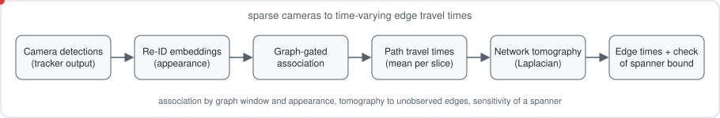
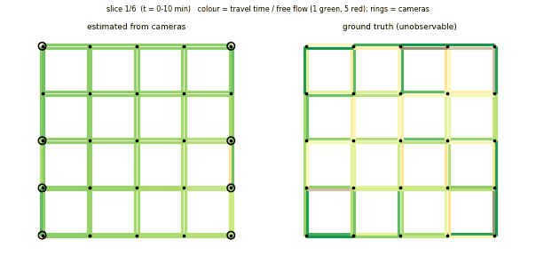
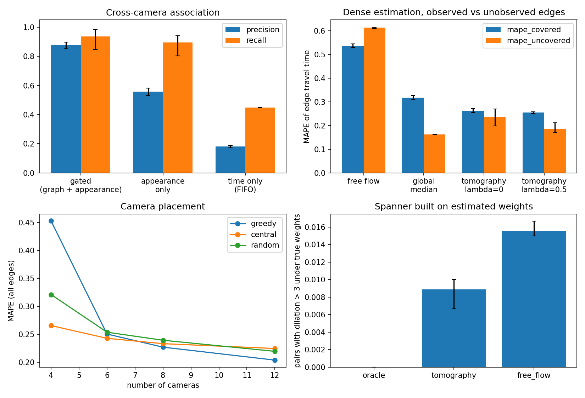
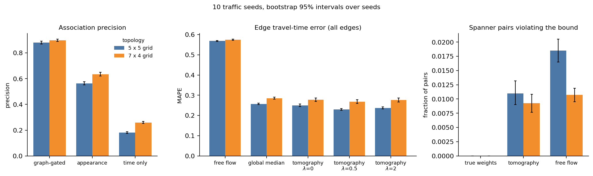

# vision-travel-time-sensing

<!-- banner -->
<p align="center"></p>


**Edge travel times from sparse multi-camera re-identification: graph-gated association, network tomography to unobserved edges, camera placement, and the sensitivity of a spanner bound to estimation error.**

Time-varying routing and spanner constructions assume edge travel times `tau_e(t)` that nobody
measures on every edge. Cameras are sparse. This package turns the detections of a few cameras into
travel-time estimates for *all* edges and quantifies how the remaining error propagates into a
`t`-spanner computed from those estimates. No detector or re-identification network is trained; the
appearance embeddings are emulated (see *Limitations*).

[](https://github.com/soheylfalahzade/vision-travel-time-sensing/actions)


<p align="center"></p>

<p align="center"></p>

<sub>Animation: per 10-minute slice, edge congestion (travel time over free flow; green 1, red 5) as estimated from 8 cameras (rings) next to the ground truth from the simulation. Grey = no ground truth in that slice. Regenerate with `vtts-gif`.</sub>

## Method in one paragraph

Cameras at nodes record passage time, incoming/outgoing edge and an embedding. For each pair of cameras on a
common row or column the shortest path is unique, so a vehicle's sub-path between them is known. Detections
are associated across the pair with a graph-derived time window plus appearance (Hungarian assignment with
a dummy option); matched time differences give path travel times per slice; a Laplacian-regularised
least-squares problem ("network tomography") distributes them over the edges; a greedy `t`-spanner built on
the estimates is then checked against the true weights. Formal definitions: [`docs/METHODS.md`](docs/METHODS.md).

## Installation (Ubuntu / WSL2)

```bash
python3 -m venv .venv && source .venv/bin/activate
pip install -e ".[dev]"
pip install -e ".[sumo]"      # required to simulate traffic
pytest
```

## Usage

```bash
vtts-eval --seeds 3 --out results/eval          # simulation + all experiments, about 5 min
vtts-gif --traffic results/eval/traffic_seed0.npz --out docs/assets/congestion.gif
```

## Experimental setup

SUMO, 5 x 5 signalised grid (150 m links, 80 directed edges), 1 h of traffic with three demand blocks
(0.30 / 0.65 / 0.30 veh/s, about 1,500 vehicles, 12% trucks), 6 slices of 10 minutes, 3 traffic seeds.
Cameras (default 8, greedy placement) detect passing vehicles with miss probability 0.08, timestamp noise
0.3 s and 32-dimensional embeddings (6 appearance classes, per-camera noise). Ground truth: mean traversal
time of each edge per slice (at least 3 traversals). All numbers are means over seeds with [min, max].

## Results

**Association** (8 cameras; precision = correct matches / matches, recall over vehicles seen at both ends):

| method | precision | recall |
|---|---|---|
| graph-gated + appearance (this package) | **0.875** [0.850, 0.898] | **0.936** [0.846, 0.984] |
| appearance only | 0.558 [0.532, 0.583] | 0.894 [0.803, 0.942] |
| time window + FIFO (no appearance) | 0.181 [0.172, 0.188] | 0.449 [0.448, 0.450] |

The time window derived from the graph removes most look-alike candidates; appearance alone confuses
vehicles of the same class. Timestamps of correct matches carry the injected 0.3 s noise (median absolute
error 0.29 s).

**Dense estimation** (MAPE of edge travel time; 60% of edges lie on a camera corridor):

| estimator | covered edges | uncovered edges | all edges |
|---|---|---|---|
| free flow | 0.536 | 0.613 | 0.566 |
| global median congestion factor | 0.318 | **0.162** | 0.256 |
| tomography, `lambda = 0` | 0.263 | 0.235 | 0.252 |
| **tomography, `lambda = 0.5`** | **0.255** | 0.185 | **0.227** [0.219, 0.238] |
| tomography, `lambda = 2` | 0.266 | 0.191 | 0.236 |

Tomography lowers the error on covered edges (0.255 vs 0.318) and overall (0.227 vs 0.256, seed ranges do
not overlap), and Laplacian smoothing helps (0.252 at `lambda = 0`). On **uncovered** edges it is worse than the
global median (0.185 vs 0.162): the simulated congestion varies by edge more than it varies smoothly across
the graph, so propagation to unobserved edges adds little beyond a global level.

**Camera placement** (MAPE over all edges; coverage = share of edges on a camera corridor):

| cameras | greedy: coverage / MAPE | central: coverage / MAPE | random: coverage / MAPE |
|---|---|---|---|
| 4 | 0.40 / 0.453 | 0.08 / 0.265 | 0.09 / 0.321 |
| 6 | 0.50 / 0.250 | 0.15 / 0.243 | 0.18 / 0.254 |
| 8 | 0.60 / 0.227 | 0.25 / 0.233 | 0.30 / 0.239 |
| 12 | 0.80 / **0.204** | 0.38 / 0.224 | 0.58 / 0.219 |

Greedy coverage maximisation gives the lowest error from 8 cameras on, but differences are small
(0.227 vs 0.233 and 0.239 at 8 cameras) and with 4 cameras it is much worse (0.453 vs 0.265): a few long
corridors carry few matched vehicles. Coverage is therefore not a sufficient criterion for placement.

**Spanner sensitivity** (busiest slice, `t = 3.0`; spanner built on the given weights, evaluated on the
true weights):

| weights used to build the spanner | pairs violating `t` | max dilation | spanner edges |
|---|---|---|---|
| oracle (true) | 0 | 2.65 | 62.3 |
| tomography estimate | 0.009 [0.007, 0.010] | 4.40 [3.60, 4.90] | 59.3 |
| free flow | 0.016 [0.015, 0.017] | 5.84 [5.59, 6.02] | 60 |

Estimated weights roughly halve the share of violating pairs compared with free-flow weights but do not
eliminate violations: a bound certified on estimated weights is not guaranteed under the true weights.



## Replication: 10 seeds and a second topology

The main experiment (three seeds, one 5 x 5 grid) was repeated with **10 traffic seeds** on the same grid and on a
different one (`examples/grid7x4.net.xml`: 7 x 4 junctions, 180 m x 120 m links, 28 junctions, 67 % camera-corridor
coverage). Values are means over seeds with a percentile bootstrap 95% interval over seeds
(`docs/results/seeds10_*.json`; regenerate with `vtts-eval --net examples/grid7x4.net.xml --seeds 10`).

| quantity | 5 x 5 grid | 7 x 4 grid |
|---|---|---|
| association precision, graph-gated | 0.881 [0.868, 0.892] | 0.897 [0.888, 0.906] |
| association precision, appearance only | 0.564 [0.551, 0.577] | 0.633 [0.620, 0.649] |
| association precision, time only | 0.180 [0.173, 0.187] | 0.260 [0.253, 0.268] |
| MAPE, all edges: tomography (lambda 0.5) | 0.229 [0.225, 0.234] | 0.268 [0.259, 0.278] |
| MAPE, all edges: global median | 0.257 [0.254, 0.261] | 0.285 [0.280, 0.291] |
| MAPE, uncovered edges: tomography | 0.190 [0.182, 0.199] | 0.250 [0.240, 0.262] |
| MAPE, uncovered edges: global median | 0.165 [0.161, 0.168] | 0.245 [0.239, 0.251] |
| spanner pairs violating the bound, estimated weights | 0.011 [0.009, 0.013] | 0.009 [0.008, 0.011] |
| spanner pairs violating the bound, free-flow weights | 0.018 [0.016, 0.021] | 0.011 [0.010, 0.012] |

<p align="center"></p>

*Association precision, all-edge travel-time error and spanner-bound violations on both topologies
(bars: means; whiskers: bootstrap 95% intervals over 10 seeds). Regenerate with `vtts-figures`.*

What replicates: graph gating raises association precision by about 0.32 (5 x 5) and 0.26 (7 x 4) over
appearance alone, and tomography lowers the all-edge error below the global-median baseline on both grids, by
11 % and 6 %. What does not: on uncovered edges the global median is at least as good as tomography (clearly
better on the 5 x 5 grid, indistinguishable on the 7 x 4 grid), and estimated weights do not remove spanner-bound
violations on either grid. Greedy coverage placement has the lowest error with 12 cameras on the 5 x 5 grid
(0.200 against 0.221 for random) but the highest with 4 cameras on both grids.

## Claims and evidence

| claim | evidence | file |
|---|---|---|
| graph gating is essential for association | precision 0.875 vs 0.558 (appearance only) vs 0.181 (FIFO) | `docs/results/results.json` |
| tomography beats a global level on covered edges | MAPE 0.255 vs 0.318, non-overlapping seed ranges | `docs/results/results.json` |
| tomography beats a global level overall | 0.227 vs 0.256, modest (12%) | `docs/results/results.json` |
| tomography helps unobserved edges | **not supported**: 0.185 vs 0.162 for the global median | `docs/results/results.json` |
| coverage-greedy placement is best | **partially supported**: best from 8 cameras, worst at 4 | `docs/results/results.json` |
| estimated weights certify a spanner bound | **not supported**: 0.9% of pairs still violate `t` | `docs/results/results.json` |

## Threats to validity

- *Construct*: embeddings are emulated (shared class component plus per-camera noise), not produced by a
  trained re-identification network; real appearance changes with viewpoint, light and occlusion.
- *Internal*: the slice statistic and regularisation were chosen on two development seeds from the same
  simulator; the ground truth is the mean traversal time of vehicles, the same quantity the tomography targets.
- *External*: one grid topology with unique straight paths; real networks have route ambiguity, and the
  time-variation of congestion across slices is modest here (mean time ratio 2.4-2.7).
- *Statistical*: ten traffic seeds are reported with bootstrap intervals in the replication section; the main tables use three seeds and ranges.

## Data and code availability

All code, configuration, seeds, the generated network and the result files behind the figures and tables are
in this repository. No external datasets are used. Exact commands and runtimes:
[`docs/REPRODUCIBILITY.md`](docs/REPRODUCIBILITY.md).

## Limitations and scope

- No real re-identification data (e.g. multi-camera vehicle benchmarks) are used; the association results
  characterise the *gating and assignment logic* under the stated embedding noise, not a deployed system.
- Only straight camera pairs are used; turning routes between cameras are not exploited.
- Edge times are summarised per slice by a clipped mean; no uncertainty intervals on `tau_e(t)` are produced yet.
- The spanner experiment uses a greedy construction on the simulated grid, not a delay-bounded time-varying
  construction.

## Roadmap

Real multi-camera re-identification data; routes with ambiguity (probabilistic path assignment); uncertainty
intervals per edge and slice and their use in conservative spanner bounds; sensor placement beyond coverage.

## Citation

See [`CITATION.cff`](CITATION.cff).

## License

MIT. See [LICENSE](LICENSE).
